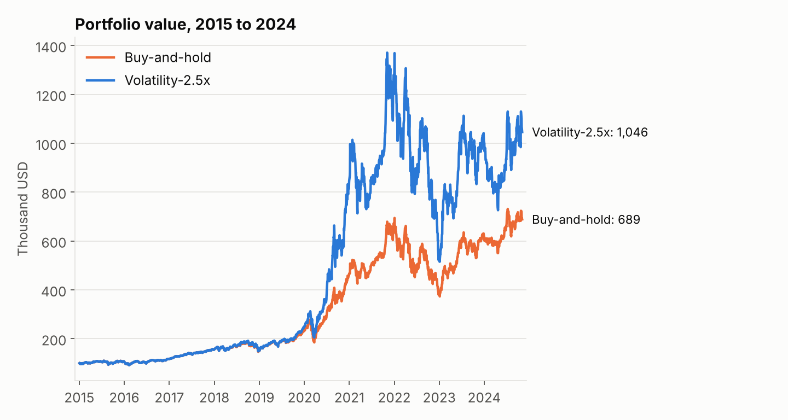
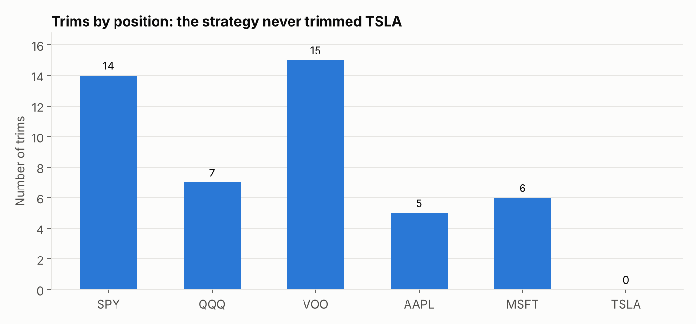
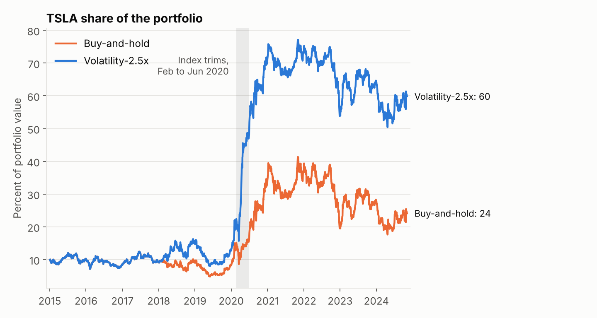
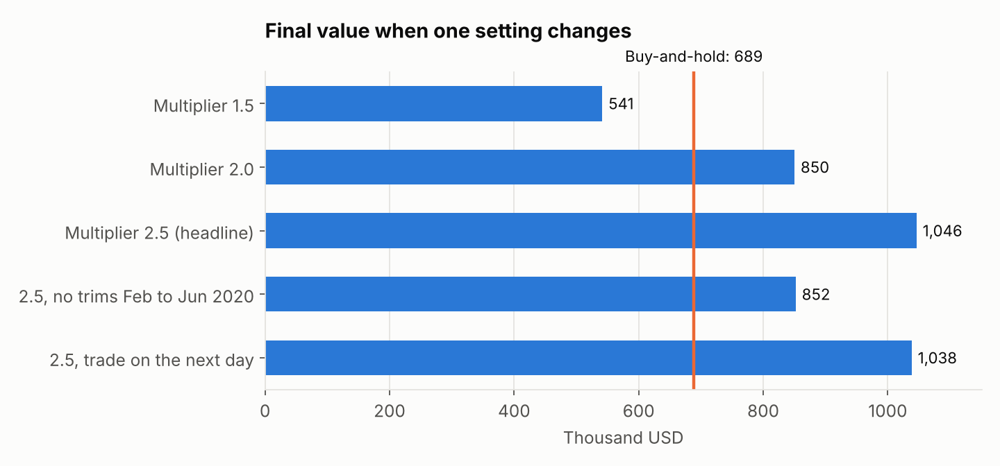
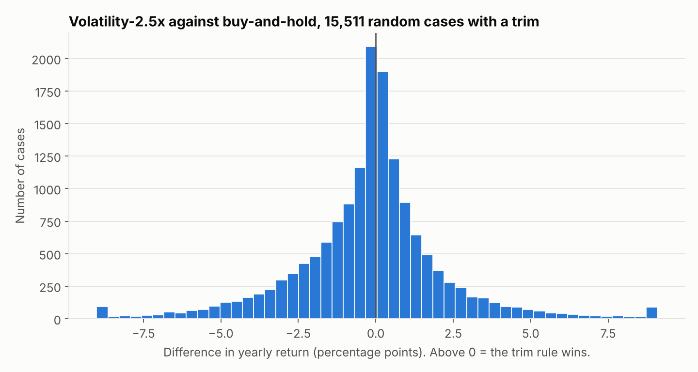
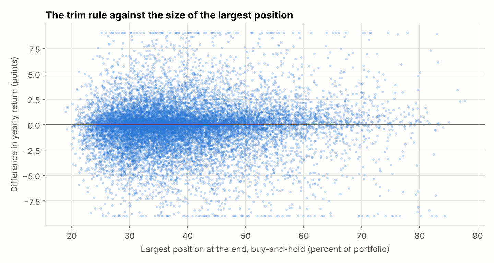

# A 52% backtest win that did not hold

An audit of my own backtest result, and the test I should have run first.

In 2025 I tested 42 ways to take profits in a stock portfolio. One strategy beat buy-and-hold by 52%.
An AI fact-checker gave the report 8.5 out of 10. I published it.

A year later I checked where the 52% came from. The answer was not in the report.
This repository shows the audit, the bugs I found in my engine, and a better test.

## The short version

- **The claim:** "Volatility-based trimming beat buy-and-hold by 52% ($1.05M against $689k)."
- **The numbers are correct.** The corrected engine gives the same result to the dollar.
- **The explanation was wrong.** The strategy did not take profits. It never trimmed its largest winner.
  It sold index funds in the 2020 crash and bought single stocks, mostly TSLA.
- **The result is fragile.** A different multiplier gives a loss against buy-and-hold.
- **The AI fact-check did not catch this.** It compared the report with the results file. It did not ask what caused the results.
- **The better test** uses 17,000 random portfolios with failed companies included. The strategy wins in 48.4% of them. It is a coin flip.

This is a study of a method. It is not investment advice.

## 1. The claim

The original portfolio was $100,000 in six positions, from January 2015 to November 2024:
SPY 30%, QQQ 20%, VOO 10%, AAPL 15%, MSFT 15%, TSLA 10%.

The strategy "Volatility-2.5x" has one rule.
When the 30-day volatility of a position is above 2.5 times its median volatility, sell 20% of that position.
Put the proceeds back into all positions in proportion to their value.

| | Final value | Yearly return | Sharpe ratio | Max drawdown |
|---|---|---|---|---|
| Buy-and-hold | $688,711 | 21.69% | 0.90 | -46.3% |
| Volatility-2.5x | $1,046,173 | 26.98% | 0.86 | -62.4% |



The original report gave this reason: the rule let the winners run, raised cash before the 2020 crash, and bought at the bottom.

## 2. The audit

Each check is in `src/audit.py`. The numbers are in `results/audit.json`.

### Check 1: Which positions did the strategy trim?

It made 47 trims. None was on TSLA.



All trims were in 2018 (18) and 2020 (29).
The reason is in the rule. The rule compares a position with its own usual volatility.
In a market crash, index fund volatility goes far above its usual level.
TSLA is volatile at all times, so its ratio stayed below 2.5.

### Check 2: Where did the money go?

The proceeds went back pro-rata, so each trim of an index fund bought more of the single stocks.
The strategy held no cash at any time.

- The TSLA share count went to 3.77 times its start value.
- TSLA was 22% of the strategy portfolio before the 2020 crash, and 49% four months later.
- TSLA reached 77% of the portfolio in November 2021. In buy-and-hold it was 41% on the same date.
- At the end, the three index funds were 10% of the strategy portfolio. In buy-and-hold they were 34%.



So the strategy was not "take profits". It was "sell index funds in a crash and buy single stocks".
That moved the portfolio into TSLA before the large rise in the TSLA price in 2020 and 2021.
It also explains the larger drawdown and the lower Sharpe ratio. The portfolio had more risk, not more skill.

### Check 3: Does the win stay without TSLA?

I removed TSLA and gave its weight to the other five positions.

| Five positions, no TSLA | Final value | Sharpe ratio | Max drawdown |
|---|---|---|---|
| Buy-and-hold | $580,686 | 0.94 | -30.1% |
| Volatility-2.5x | $690,876 | 0.97 | -32.1% |

The win falls from 52% to 19%. So most of the win came through TSLA, but not all of it.
The part that stays is the same move: out of index funds and into AAPL and MSFT, in a decade when those two beat the index.
One portfolio cannot show if that is a real effect or luck. Section 4 tests it.

### Check 4: Does the win stay when one setting changes?



- With a multiplier of 1.5, the strategy ends at $541,437. That is below buy-and-hold.
- Without the trims from February to June 2020, it ends at $852,103. One period gave about half of the win.
- With trades on the day after the signal, it ends at $1,038,336. The same-day trade was not the problem.

I tested 42 strategies and put the best one in the headline.
With 42 tries on one portfolio and one period, a large win for one of them is not a surprise.

### Check 5: Are the risk numbers correct?

No. I found three bugs in the original engine (`original/run_backtest_index_focus.py`).

| Bug | Effect |
|---|---|
| For strategies that hold cash, the engine added the final cash balance to all days. | The risk numbers of 28 of the 42 strategies can be wrong. See the table below. |
| The report said the Sharpe ratio used a 2% risk-free rate. The code used 0%. | With 2%, buy-and-hold is 0.82 and the strategy is 0.80. |
| The "yield" mode set a 4% T-bill rate and did not use it. | The cash earned nothing. |

The effect of the cash bug on four strategies:

| Strategy | Sharpe, original | Sharpe, corrected | Max drawdown, original | Max drawdown, corrected |
|---|---|---|---|---|
| Trim@+50% (cash) | 0.48 | 0.98 | -24.7% | -26.1% |
| Trim@+100% (cash) | 0.61 | 0.96 | -30.0% | -32.8% |
| Trim@+100% (yield-volatility) | 0.95 | 0.97 | -35.1% | -35.1% |
| Volatility-2.5x (yield-volatility) | 0.78 | 0.87 | -59.7% | -44.4% |

The original report said that strategies with cash "destroyed returns".
On return, that is correct: Trim@+50% (cash) ends at $443,061.
On risk, the bug hid the other side. With the correct cash record, its Sharpe ratio is 0.98, above the 0.90 of buy-and-hold.

## 3. What the AI fact-check did and did not do

The original project used four AI agents. One of them was a fact-checker.
Its report is in `original/FACT_CHECK_REPORT_DC_VOICE.md`.

What it did:

- It compared each number in the report with the results file.
- It recalculated the yearly return from the final values.
- It examined the wording of the assumptions.
- Its verdict was "Pass with Minor Revisions", with a rating of 8.5 out of 10.

What it did not do:

- It did not read the list of trades.
- It did not ask which position made the money.
- It did not read the engine code, so it did not find the three bugs.

The agent did a consistency check: does the report agree with the results?
The flaw needed a cause check: why are the results what they are?
A report can pass the first check and fail the second.
This is one case, not a study of AI fact-checkers. But the two questions are different, and I asked only the first.

## 4. The better test: 17,000 random portfolios

One portfolio and one period give one story. So I asked the same question many times.

- **Portfolios:** 1,000 random portfolios for each start year. Each has 6 positions with random weights.
- **Periods:** 17 start years, from 2003 to 2019. Each gives one 5-year window. That is 17,000 cases.
- **Companies:** a portfolio can only hold companies that were in the S&P 500 on its start date.
  A list from today knows which companies won. A list from the start date does not.
- **Failed companies stay in.** When a company leaves the market, its position stays at the last price to the end of the window.
  In each window, 22 to 49 of the available companies left the market.
- **Trades** occur on the day after the signal. Proceeds go back pro-rata.

The code is in `src/random_portfolios.py`. The numbers are in `results/random_portfolios_finsaber.json`.

### Result

A case with no trim is equal to buy-and-hold. The rates below use the cases with one trim or more.

| Rule | Cases with a trim | Higher return than buy-and-hold | Higher Sharpe ratio | Median difference in yearly return |
|---|---|---|---|---|
| Volatility-2.5x | 15,511 | 48.4% | 45.9% | -0.03 points |
| Trim at +100% | 15,030 | 49.9% | 57.0% | 0.00 points |

- **Volatility-2.5x is a coin flip, with a small cost.** It wins on return in 48.4% of the cases. The mean difference is -0.20 points a year.
- **Half of the cases are within 1 point a year of buy-and-hold.** In 9 of 10 cases the difference is between -4.4 and +3.7 points.
- **My original result was in the top 2.3%.** The original portfolio won by 5.3 points a year over its 10 years. Only 2.3% of the random 5-year cases won by that much.
- **Trim at +100% does not change the return.** It gives a higher Sharpe ratio in 57.0% of the cases. That is a small effect on risk, and the test does not include tax, which works against each trim.



### The start year decides the result

| Start year | Volatility-2.5x wins | Median difference | Trim at +100% wins | Median difference |
|---|---|---|---|---|
| 2003 | 55.7% | +0.05 | 40.3% | -0.12 |
| 2004 | 55.2% | +0.16 | 57.0% | +0.08 |
| 2005 | 43.8% | -0.29 | 53.7% | +0.03 |
| 2006 | 46.4% | -0.17 | 57.4% | +0.03 |
| 2007 | 50.2% | +0.01 | 57.6% | +0.04 |
| 2008 | 52.9% | +0.22 | 47.3% | -0.01 |
| 2009 | 38.2% | -0.35 | 51.7% | +0.02 |
| 2010 | 61.4% | +0.04 | 56.8% | +0.05 |
| 2011 | 53.7% | +0.04 | 41.2% | -0.07 |
| 2012 | 51.5% | +0.01 | 52.9% | +0.02 |
| 2013 | 63.4% | +0.15 | 49.1% | -0.01 |
| 2014 | 65.1% | +0.22 | 47.4% | -0.01 |
| 2015 | 63.0% | +0.22 | 32.5% | -0.09 |
| 2016 | 39.6% | -0.30 | 35.1% | -0.12 |
| 2017 | 37.5% | -0.50 | 44.5% | -0.05 |
| 2018 | 28.9% | -1.01 | 66.8% | +0.11 |
| 2019 | 31.2% | -0.88 | 61.3% | +0.10 |

The four windows that include the 2020 crash (start years 2016 to 2019) are the worst for Volatility-2.5x.
In those windows the rule wins in 29% to 40% of the cases.
That is the same crash that gave my original portfolio its win.
In a crash, the rule moves money out of the positions with the largest rise in volatility.
For most portfolios that move cost money. In my portfolio it moved money into TSLA.



### Is the price data good?

The prices come from the [FINSABER dataset](https://huggingface.co/datasets/waylonli/FINSABER-data) on Hugging Face.
It has 1,017 symbols from 2000 to 2024, and 334 of them stopped trading before the middle of 2024.
The dataset page does not name the price source, so I made two checks.

- **Against Yahoo Finance** (`src/compare_sources.py`): 102 symbols are in both sources. For 100 of them, the daily returns have a correlation of 0.999 or more.
  For 96 of them, the total growth from 2012 to 2024 agrees within 5%. The 6 others are companies with a spin-off.
- **Bad series:** some symbols have bad rows, or a second company uses the symbol after the first one left the market.
  One symbol had a price of 7.73 on one day and 141,630 on the next. I removed 37 symbols and cut 59 short. The rules are in `repair_finsaber`.
  Before this repair the win rate of Volatility-2.5x was 48.9%. After it, 48.4%.

The test covers 384 to 487 companies for each start year. The index had about 500, so the cover is 78% to 96%.

### Cross-check with a second universe

I ran the same test on Yahoo Finance prices for 103 large companies from the end of 2014 (`src/universe.py`), for start years 2015 to 2021.
This list is compiled by hand and has no failed companies.
Volatility-2.5x won on return in 42.9% of 6,730 cases. The median difference was -0.14 points a year.
In this test my original portfolio won by 1.8 to 21.8 points a year in the windows that start from 2015 to 2020.
The result agrees with the main test: the rule has no edge, and my portfolio was an exception.

## Five checks for a backtest result

1. **Read the trades.** Which positions did the strategy trade, and when? Does that agree with the explanation?
2. **Follow the weights.** Did one position become most of the portfolio?
3. **Remove the best position.** Does the result stay?
4. **Change one setting.** Does the result stay with a different parameter, or without the best period?
5. **Test many portfolios.** One portfolio is one story. Many portfolios give a rate.

## Run it

Python 3.10 or later is necessary.

```bash
python -m venv .venv
source .venv/bin/activate
pip install -r requirements.txt

python tests/test_engine.py                  # 11 checks
python src/audit.py                          # section 2, writes results/audit.json and charts

python src/download_finsaber.py              # prices for section 4, about 250 MB from Hugging Face
python src/random_portfolios.py finsaber     # section 4, about 2 minutes

python src/download_universe.py              # prices for the cross-check, from Yahoo Finance
python src/random_portfolios.py yahoo        # the cross-check
python src/compare_sources.py                # FINSABER against Yahoo
```

The price files for section 2 are in `data/`. All tools and data are free. No account and no key are necessary.

## Layout

```
src/engine.py              the engine: signals, simulation, metrics
src/audit.py               the five checks of section 2
src/random_portfolios.py   the test of section 4
src/download_finsaber.py   price download for section 4
src/universe.py            the stock list for the cross-check
src/download_universe.py   price download for the cross-check
src/compare_sources.py     FINSABER prices against Yahoo prices
src/plots.py               chart style
data/sp500_members.csv     S&P 500 membership dates
tests/test_engine.py       checks for the engine
results/                   the numbers in this file
charts/                    the charts in this file
original/                  the 2025 engine, report and fact-check, not changed
```

## Limits

- **No costs and no tax.** All results are before trading costs and capital gains tax. Tax makes each trim rule worse.
- **Two trim rules only.** Section 4 tests Volatility-2.5x and Trim at +100%. It does not test the 40 other strategies of the original report.
- **5-year windows that overlap.** The 17 windows share years, so the 17,000 cases are not independent.
- **Cover of the index is 78% to 96%.** The companies that are not in the price file are not a random sample.
- **A failed company stays at its last price.** For a bankruptcy that is near zero, which is correct. For an acquisition, the cash stays idle to the end of the window.
- **The price source of FINSABER is not known.** The check against Yahoo covers large companies from 2012. It does not cover the failed companies.
- **Not advice.** This project tests a method. It does not tell you what to buy or sell.

## Data sources

- **FINSABER price file:** [waylonli/FINSABER-data](https://huggingface.co/datasets/waylonli/FINSABER-data) on Hugging Face, Apache-2.0 license. Not in this repository. `src/download_finsaber.py` gets it.
- **S&P 500 membership dates:** `data/sp500_members.csv` is `sp500_ticker_start_end.csv` from [fja05680/sp500](https://github.com/fja05680/sp500), MIT license, copyright (c) 2019-2020 Farrell J. Aultman.
- **Yahoo Finance prices:** through the `yfinance` package. The six files in `data/` are the files of the original project.
